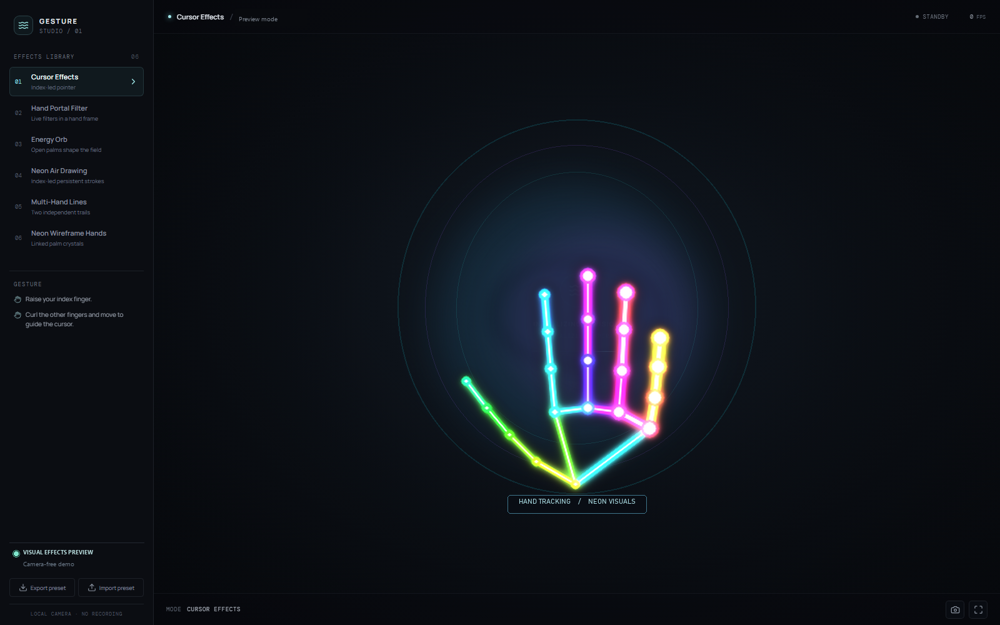

# Gesture Studio

A webcam-driven hand-effects studio with six selectable modes. The browser version processes camera frames and landmarks locally; the camera feed is never recorded. A Python/OpenCV desktop version is also included for direct webcam use.



## Run the browser studio

```sh
npm install
npm run dev
```

Open the local URL in a modern browser and grant camera permission. Camera access requires `localhost` or HTTPS. The hand model and MediaPipe runtime load from their public CDNs; an internet connection is required on first load. Production output can be created with `npm run build`.

## Run the Python desktop studio

Install Python 3.10 or newer, then install the vision dependencies and launch the webcam app:

```sh
python -m pip install -r requirements.txt
python hand_gesture_studio.py
```

Grant camera access to the operating system if prompted. The Python app uses OpenCV's preview window; press `Q` or `Esc` to close it. On systems without a camera, the app reports that it could not open the webcam.

## Effects and gestures

- **Cursor Effects** — extend the index finger and curl the other fingers; a smoothed, glowing pointer follows the fingertip.
- **Hand Portal Filter** — place both hands in view. The four thumb/index tips define a smoothed convex portal. Hold an open palm for one second or press `N` to cycle through red halftone, perspective grid, pop-art, ordered dither, chromatic shift, thermal, sepia, and frosted-glass filters.
- **Energy Orb** — show two open palms. Their midpoint and spacing control a pulsing orb with animated rings, lightning, and particles.
- **Neon Air Drawing** — keep only the index finger extended to draw smooth persistent strokes. Pinch/curl to lift the pen. Hold an open palm for one second or press `C` to clear; `U` undoes the last stroke. Camera preview appears as a picture-in-picture.
- **Multi-Hand Lines** — extend both index fingers for independent trails. Colors follow the detected left/right hand labels.
- **Neon Wireframe Hands** — one or two palms anchor rotating 3D octahedra; corresponding fingertips are joined by rainbow beams. `G` toggles glow, `R` changes rotation speed, `B` toggles beams, and `P` toggles particles.

Press `M` to cycle effects or hold a thumbs-up for about one second to switch to the next effect.

The Python app includes all six effects. Its keyboard controls are `M` (next effect), `N` (next portal filter), `C` (clear drawing), `U` (undo drawing), `G`/`Shift+G` (decrease/increase glow), `R` (rotation speed), `B` (toggle beams), `P` (toggle particles), and `Q`/`Esc` (quit).

The selectors and sidebar cues are based on the supplied references: Video 1 shows a luminous purple air-drawn line/doodle; Video 2 shows two hands framing and changing the span of a projected region; Video 3 shows simultaneous multicolored hand-controlled lines. The sphere mode uses Video 2's two-hand spacing interaction to control an energy field.

## Effects Library presets

**Export preset** downloads a small JSON preset selecting the current built-in effect; **Import preset** validates that file and selects the named built-in effect. This imports effect selection metadata only, not executable third-party code or new effect modules.

The browser renderer uses Canvas 2D in the existing React animation loop and throttles MediaPipe inference. The portal processes a reduced-resolution camera buffer to keep per-frame work bounded. The Python renderer uses OpenCV and NumPy with MediaPipe Hands and keeps the camera preview and effects in one desktop window.
